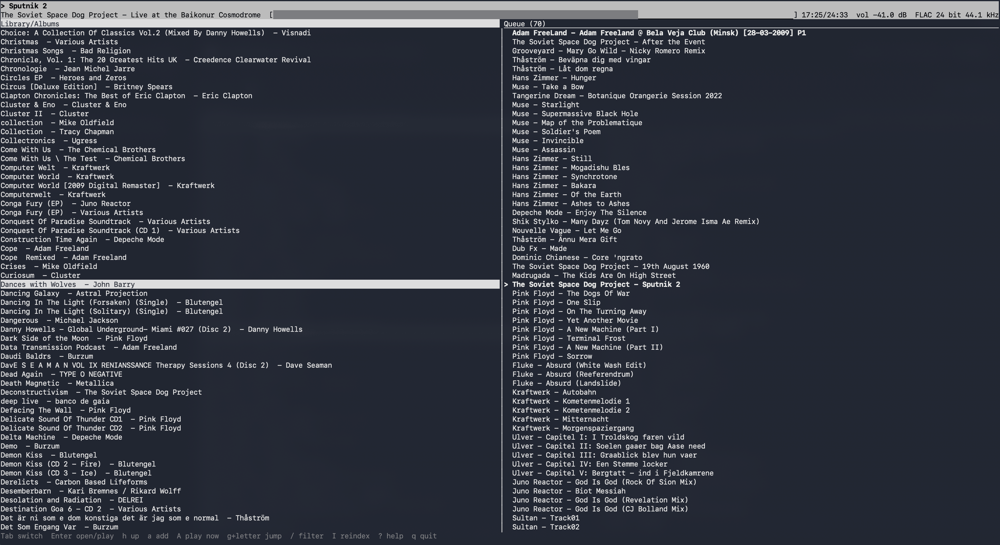

# bluplay

**A minimalistic terminal music player for BluOS streamers — browse your local music library by folder/album and manage the play queue. Nothing else: no streaming services, no radio, no settings menus.**

bluplay is a small, dependency-free C program that talks to a BluOS player (Bluesound, NAD, ...) over its
HTTP API on your LAN. It is aimed at people who keep their music as files on a NAS or network share that
the player indexes, and who want to pick albums and tracks from a keyboard-driven terminal UI.

**Platforms:** Linux and macOS (any POSIX system with a C99 compiler and a UTF-8 terminal). Tested on Slackware Linux 15.0. Windows is not supported natively; use WSL.

## Screenshot



## Features

- Starts with a flat A–Z list of all albums in the player's library; go up to browse by Artists, Songs, folders etc.
- Two panes: library (left) and play queue (right); `Tab` switches between them
- Play now, add to the end of the queue, play a whole album or folder
- Queue editing: remove one track, a range (Shift+arrows or `v` select mode), or clear the queue — removals show instantly and are synced in the background
- Transport: play/pause, next, previous, seek ±10 s, volume in dB
- Type-ahead jump (`g` + letter) and substring filter (`/`)
- Shows the stream format of the playing track (e.g. `FLAC 24 bit 96 kHz`) and a progress bar in the (reverse-video) now-playing lines
- Random mode that keeps the queue topped up with random tracks or albums from the whole library
- Library reindex with progress (`I`, or `bluplay --reindex`)
- Play files from the shell: `bluplay FILE|DIR...` queues files that live in the player's library share, or serves other local files to the player over HTTP
- Scriptable: `--status`, `--queue`, `--reindex`, `--discover`
- Simple multi-room grouping (`G`, or `--group` / `--ungroup`)
- Finds the player automatically with mDNS/DNS-SD
- Live updates via BluOS long-polling; handles resizes, slow links and terminals that cannot send Shift+arrows
- One C file, no dependencies beyond libc: no ncurses, no libcurl, no XML library

## Requirements

- A BluOS player on the same network (tested on a NAD C390DD with BluOS 4.16; see [Tested hardware](#tested-hardware))
- A POSIX system (Linux, macOS, *BSD should work) with a C compiler (C99/gnu11) and `make`
- A UTF-8 terminal (xterm, GNOME Terminal, Konsole, iTerm2, Terminal.app, tmux/screen, the Linux console)
- Optional: `avahi-browse` (Linux) as a discovery fallback; Python 3 + [`pyte`](https://pypi.org/project/pyte/) to run the tests

bluplay draws the UI itself with termios and standard ANSI/VT100 escape sequences, so it does **not** need
ncurses or any other library.

## Install

Every [GitHub release](https://github.com/fredrikspang-sys/bluplay/releases) has ready-made x86_64 packages
and a `SHA256SUMS` file (check with `sha256sum -c --ignore-missing SHA256SUMS`). Replace `VER` with the
version, e.g. `0.2.0`. The prebuilt binaries only need glibc; release 0.1.1 needs glibc 2.33 or newer (Slackware 15,
Debian 12, Ubuntu 22.04, Fedora 34 or later); otherwise build from source (below).

| Format | Install |
|---|---|
| Slackware 15 (`bluplay-VER-x86_64-1_SBo.txz`) | `installpkg bluplay-VER-x86_64-1_SBo.txz` (as root; remove with `removepkg bluplay`) |
| Slackware, built from source | the SlackBuild in [`slackbuild/bluplay/`](slackbuild/bluplay): put `bluplay-VER.tar.gz` next to it, run `./bluplay.SlackBuild` as root, then `installpkg /tmp/bluplay-VER-*.txz` |
| Debian / Ubuntu (`bluplay_VER-1_amd64.deb`) | `sudo apt install ./bluplay_VER-1_amd64.deb` |
| Fedora / RHEL / openSUSE (`bluplay-VER-1.x86_64.rpm`) | `sudo dnf install ./bluplay-VER-1.x86_64.rpm` (or `zypper install`) |
| Any x86_64 Linux (`bluplay-VER-linux-x86_64.tar.gz`) | `tar xzf bluplay-VER-linux-x86_64.tar.gz && install -m 755 bluplay-VER-linux-x86_64/bluplay ~/.local/bin/` |
| Source (`bluplay-VER.tar.gz`) | `tar xzf bluplay-VER.tar.gz && cd bluplay-VER && make && sudo make install` |

## Build and install

```sh
make                         # builds ./bluplay
sudo make install            # installs /usr/local/bin/bluplay
make install PREFIX=$HOME/.local   # or install for your user only (no root)
make install DESTDIR=/tmp/pkg PREFIX=/usr   # staged install (bin + README/LICENSE in share/doc/bluplay)
```

Packages needed to build, per system:

| System | Install |
|---|---|
| Slackware | a full install already has `gcc` and `make` (series `d`) |
| Debian / Ubuntu / Raspberry Pi OS | `sudo apt install build-essential` |
| Arch Linux | `sudo pacman -S --needed base-devel` |
| Fedora | `sudo dnf install gcc make` |
| macOS | `xcode-select --install` (Command Line Tools); Homebrew is not needed |

No ncurses development package is required on any of them.

Other make targets: `make san` (AddressSanitizer + UBSan build, `./bluplay-san`), `make test`, `make test-san`,
`make uninstall`, `make clean`.

## Usage

```sh
bluplay                          # full-screen player (finds the player via mDNS)
bluplay --host 192.0.2.10        # use a specific player (IP or host name, optionally :PORT)
bluplay ~/Music/Some\ Album      # play a folder now, then open the player
bluplay --status                 # one line of player status
bluplay --queue                  # print the play queue
bluplay --reindex                # rescan the player's library, with progress
bluplay --discover               # list BluOS players found on the network
bluplay --seek 90                # jump to 1:30 in the current track (--seek +30 / -30: relative)
bluplay --group 192.0.2.11       # add that player to this player's group (--ungroup removes it)
bluplay --help
```

## Configuration

Settings are read from, in increasing priority:

1. the config file `~/.config/bluplay/config` (or `$XDG_CONFIG_HOME/bluplay/config`, or the file given by `-c FILE` / `BLUPLAY_CONFIG`)
2. environment variables `BLUPLAY_*`
3. command-line flags

If no player host is set anywhere, bluplay looks for one on the network (see [Discovery](#player-discovery)).

The config file is plain `key = value`, one per line; `#` starts a comment; values may be quoted.

```ini
# ~/.config/bluplay/config
host = 192.0.2.10            # player IP or host name (port can be given as host:port)
port = 11000                 # BluOS HTTP API port (default 11000)

# Optional: lets "bluplay FILE..." queue files from your library share as library tracks
# and lets bluplay read bit depth/sample rate from the files.
library_root = ~/Music       # where the share with your music is mounted on this computer
player_root  = /var/mnt/NAS-Music   # the same folder as the player names it (see below)

db_offset = 0                # added to the volume shown in dB (e.g. to match an amplifier's display)
random = off                 # track | album | off: start with random mode on
shuffle = off                # on | off: set the player's shuffle at start (leave out = unchanged)
repeat = off                 # off | queue | track: set the player's repeat at start (leave out = unchanged)
discovery = on               # set to off to never search the network
discovery_timeout = 2        # seconds to wait for mDNS answers
```

| Setting | Flag | Environment | Default |
|---|---|---|---|
| `host` | `-H`, `--host HOST[:PORT]` | `BLUPLAY_HOST` | discovered |
| `port` | `-p`, `--port PORT` | `BLUPLAY_PORT` | `11000` |
| `library_root` | `-L`, `--library-root DIR` | `BLUPLAY_LIBRARY_ROOT` | none |
| `player_root` | `-P`, `--player-root PATH` | `BLUPLAY_PLAYER_ROOT` | none |
| `shares` | | `BLUPLAY_SHARES` | none |
| `db_offset` | `--db-offset DB` | `BLUPLAY_DB_OFFSET` | `0` |
| `random` | `--random [album]` | `BLUPLAY_RANDOM` | off |
| `shuffle` | `--shuffle [on\|off]` | `BLUPLAY_SHUFFLE` | unchanged |
| `repeat` | `--repeat off\|queue\|track` | `BLUPLAY_REPEAT` | unchanged |
| `discovery` | `--no-discover` | `BLUPLAY_DISCOVERY` | on |
| `discovery_timeout` | | | `2` |
| config file | `-c`, `--config FILE` | `BLUPLAY_CONFIG` | `~/.config/bluplay/config` |

**Library root and player root.** The player reads your music from a network share and reports each track as
a path in its own namespace. To find `player_root`, play a track from your library and run `bluplay --status`:
the `file=` field shows the player's path, e.g. `file=/var/mnt/NAS-Music/Artist/Album/01 Song.flac` for a file
that you see locally as `~/Music/Artist/Album/01 Song.flac`; then `library_root = ~/Music` and
`player_root = /var/mnt/NAS-Music`. Several mappings can be given with
`shares = /local/dir1=/player/path1;/local/dir2=/player/path2`. Without a mapping, browsing and playback work
normally; `bluplay FILE...` then serves the files to the player over HTTP instead (one at a time, from the
computer running bluplay, only while bluplay runs).

## Player discovery

When no host is configured, bluplay sends an mDNS (multicast DNS / DNS-SD) query for the service types
`_musc._tcp`, `_musp._tcp` and `_musz._tcp` to `224.0.0.251:5353` and collects answers for about 2 seconds.
This is implemented directly in C (a one-shot "legacy unicast" query, RFC 6762 §6.7), so it needs no
Avahi or Bonjour libraries. If nothing answers and `avahi-browse` is installed, bluplay asks Avahi as a fallback.

- One player found: it is used, and its name and address are printed.
- Several found: in the full-screen player you are asked to pick one (Enter = the first). In non-interactive
  modes (`--status`, `--queue`, file playback) the first one is used and named on stderr. `_musc` players
  are listed before `_musp` and `_musz`.
- None found: the full-screen player starts anyway, shows `Waiting for player… (searching the network every 5 s)`
  and repeats the search in the background (keys keep working) until a player answers, then connects.
  Non-interactive modes (`--status`, `--queue`, `--reindex`, file playback) still exit with a message
  explaining how to set the host.

## Player turned off / unreachable

bluplay does not need the player to be on when it starts. If the configured (or discovered) player does not
answer, the full-screen player starts anyway and shows `Waiting for player HOST… (retrying every 4 s)`. It
probes `/Status` at most every 4 seconds (short, non-blocking requests, no busy loop). As soon as the player
answers it shows `Connected to HOST`, loads the library (and the Albums view) if that had failed, and
everything works normally. The same applies if the player drops out later (e.g. the amp is switched off):
bluplay keeps retrying every 4 seconds and picks up again when it is back. Typical use: start bluplay, then
power on the amp.

`bluplay --discover` lists everything found, as `address:port<TAB>name<TAB>service`. Discovery only works
when multicast reaches your computer: same LAN/VLAN as the player, UDP 5353 allowed by the firewall, and no
VPN capturing the traffic. Setting `host` avoids the delay and these requirements.

## Multi-room grouping

Press `G` in the player: bluplay searches the network (mDNS, as above) and shows the other players in the
bottom line, `[x]` marking those already in this player's group (read from `/SyncStatus`). Press `1`-`9` to
add or remove that player; any other key closes the list. The player bluplay controls is the group master
(BluOS `/AddSlave` and `/RemoveSlave`), so playback, queue and volume commands go to it and the grouped
players follow. From a shell: `bluplay --group IP[:PORT]` and `bluplay --ungroup IP[:PORT]`.

## Keybindings

Global (both panes):

| Key | Action |
|---|---|
| `Tab` | switch focus between library and queue |
| `j` / `Down`, `k` / `Up` | move down / up |
| `PgDn` / `PgUp` | move 15 rows |
| `Home` / `End` | first / last row |
| `Space` | pause / play |
| `n` | next track |
| `p` | restart the track; press twice for the previous track (BluOS `/Back`) |
| `+` or `=` / `-` | volume up / down 2 dB |
| `,` / `.` | seek back / forward 10 s (tracks with a known length; not radio/streams) |
| `s` | shuffle on/off (player shuffles the current queue's play order) |
| `r` | repeat: off -> queue -> track -> off |
| `m` | mute on/off (the volume level is kept; `MUTED` in the top line) |
| `S` | stop (`Space` starts again) |
| `z` | sleep timer: off -> 15 -> 30 -> 45 -> 60 -> 90 min -> off (`sleep Nm` in the top line) |
| `P` | presets: list the player's presets, `1`-`9` plays one |
| `R` | random mode on/off |
| `I` | reindex the player's library (asks y/n) |
| `G` | group players: list others on the network, `1`-`9` adds/removes one (see [Multi-room grouping](#multi-room-grouping)) |
| `?` | help screen (any key closes it) |
| `Esc` | cancel selection |
| `q`, `Ctrl-C` | quit |

Library pane:

| Key | Action |
|---|---|
| `Enter`, `l`, `Right` | open folder/album (the album list is kept in memory and re-opens instantly; other folders are fetched when opened); on a track: play it now |
| `h`, `Backspace`, `Left` | clear the filter, or go up one level |
| `a` | add the selected item (track, album or folder) to the end of the queue |
| `A` | play the selected item now (inserted after the current track; the queue is kept) |
| `g` + letter | jump to the first entry starting with that letter; `g` + `0` or `#`: first entry not starting with a letter; `Esc` cancels |
| `/` | filter by substring (type, then `Enter`; `Esc` cancels) |
| `u` | update: fetch the current list again from the player (the album list too; it is also refetched automatically after indexing) |

Queue pane:

| Key | Action |
|---|---|
| `Enter` | play the selected track |
| `d`, `Delete` | remove the selected track (or, with a selection, the selected tracks after y/n) |
| `D` | clear the whole queue (or remove the selection), after y/n |
| `Shift`+`Up`/`Down`/`PgUp`/`PgDn`/`Home`/`End` | select a range from the anchor |
| `J` / `K` | move the selected track down / up one place |
| `v` | toggle select mode (for terminals that do not send Shift+arrows): move to extend, `v` or `Esc` ends |

Confirmation prompts accept `y`/`Y`; any other key cancels.

## Tested hardware

- NAD C390DD with the BluOS module, BluOS 4.16

Other BluOS 3/4 players (Bluesound Node, Powernode, Vault, NAD M10/M33, ...) use the same API and are
expected to work, but have not been tested. Reports are welcome.

## Limitations

- Local library only: no streaming services, internet radio or player settings (presets can only be played, with `P`).
- IPv4 only.
- Grouping is basic: the player bluplay controls is always the group master, and at most 9 other players are listed.
- Some modern terminal emoji/wide characters may be measured incorrectly (bluplay has its own small
  character-width table).
- Files outside the library share are served over HTTP one at a time and cannot be placed in the player's queue.
- The bundled tests use a fake player; behaviour with real devices beyond the tested model is unverified.

## Release packaging

`make dist` makes the source tarball `bluplay-VERSION.tar.gz` from `HEAD`. `scripts/release.sh [VERSION]`
builds every release file into `dist/` from tag `vVERSION`: source tarball, prebuilt tarball, `.deb` and `.rpm`
(with [nfpm](https://nfpm.goreleaser.com)), the Slackware `.txz` (with the SlackBuild) and `SHA256SUMS`. It also
updates `slackbuild/bluplay/bluplay.info` (VERSION, DOWNLOAD, MD5SUM); `--upload` attaches the files to the existing
GitHub release with `gh`. Pushing a `v*` tag runs `.github/workflows/release.yml`, which does the same in a Debian 11
container and attaches the files to the release.

## Tests

`make test` builds bluplay and runs `tests/smoke.py`, which starts `tests/fake_player.py` (a small fake
BluOS HTTP API on 127.0.0.1) and `tests/fake_mdns.py`, then checks the command-line modes, configuration
precedence, discovery and the full-screen UI (driven through a pseudo-terminal with `pyte`). The tests never
contact a real player. `make test-san` runs the same tests against the sanitizer build.
`BLUPLAY_MDNS_ADDR=ip:port` (test hook) sends the discovery query to that address instead of the multicast group.

## Disclaimer

bluplay is an independent project. It is not affiliated with, endorsed by or supported by Bluesound, NAD
Electronics or Lenbrook Industries. BluOS, Bluesound and NAD are trademarks of their respective owners. It uses
the player's documented/observable local HTTP API; use at your own risk.

bluplay is unrelated to the "bluplayer" Bluetooth audio project.

## License

MIT — see [LICENSE](LICENSE).
